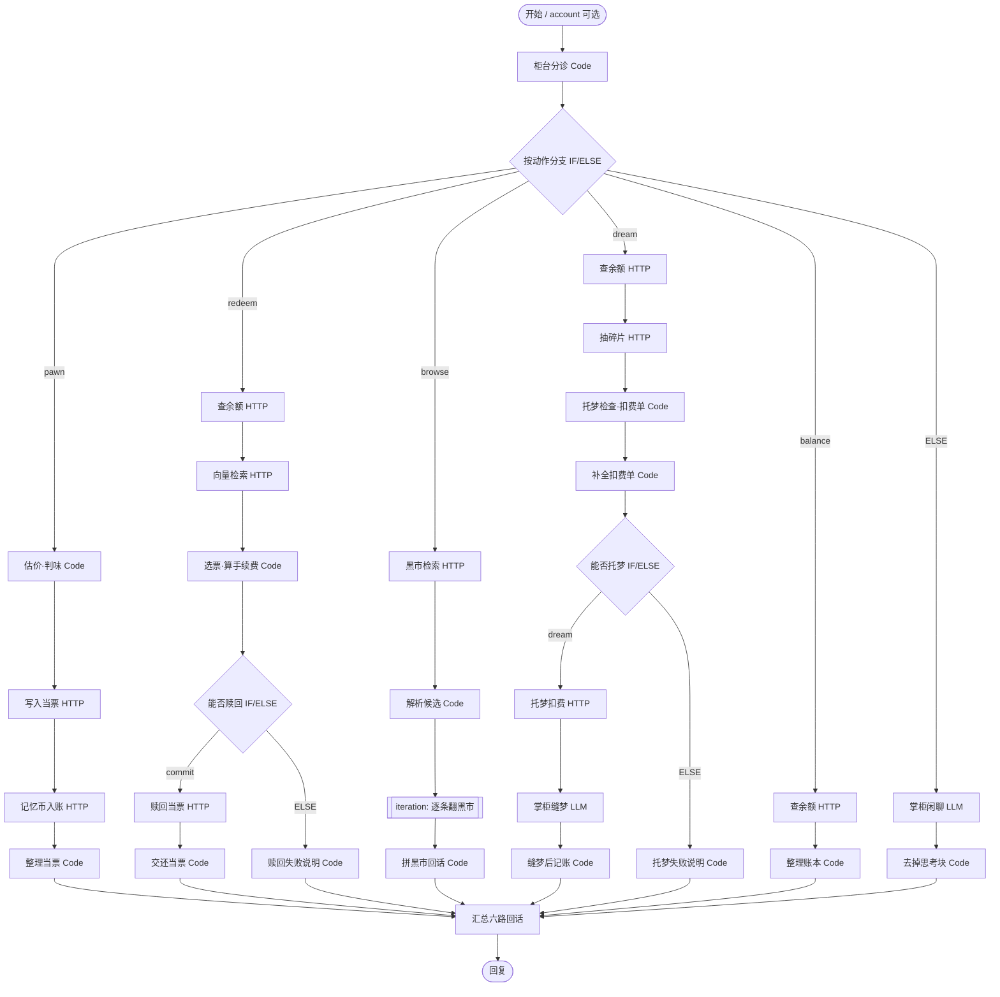

# 记忆当铺 · Memory Pawnshop

一个用 **Dify** 搭起来的聊天应用：把一段记忆当掉，换几枚「记忆币」；只给一条线索，掌柜会凭 **seekdb 向量检索** 从柜底把那张旧当票找回来。

> OceanBase 2026 数据库大赛 · Just for Fun「用 Dify 做一个好玩的智能应用」
>
> Dify 1.19 Chatflow（分支 + 迭代）+ seekdb（原生向量 / 全文索引）+ MiniMax 掌柜（可选）

**创意**：把「记忆」当成可以典当的旧物。你说一段往事，当铺给它估价、判情绪、开当票；想找回时不用复述全文，给一条线索（「便利店」「关东煮」），柜台就从你自己的存当里做向量检索，按相似度收手续费。还能逛别人的黑市、把存当缝成一场梦。12 段公开记忆（[`app/seed.py`](app/seed.py)）是为演示原创的示例数据；本项目未复用公开工作流、代码或数据集。

## 0. 这次重做解决了什么

上一版被打回的核心原因是「Dify 里只有一条直线，玩法都在后端」。这一版逐条修正：

| 上一版的问题 | 这一版的做法 | 可核对的位置 |
| --- | --- | --- |
| 两份 DSL 都是线性链，无分支/迭代 | 6 路 `IF/ELSE` 动作扇出；赎回、托梦各有嵌套 `IF/ELSE`；黑市用 `iteration` 逐条格式化检索结果 | [`dsl/memory-pawnshop.yml`](dsl/memory-pawnshop.yml)、[`records/workflow-canvas.png`](records/workflow-canvas.png) |
| 估价、情绪、手续费、钱包账本、托梦都在 FastAPI，单接口转发 | 这些决策全部搬进 Dify 的 Code / LLM 节点；FastAPI 只保留鉴权、向量化、seekdb 读写与事务 | [`scripts/build_dsls.py`](scripts/build_dsls.py) 中各 Code 模板；[`app/service.py`](app/service.py) |
| hash 字面向量不是语义 | 默认改为 fastembed `paraphrase-multilingual-MiniLM-L12-v2`（384 维，镜像内预下载，运行时离线）；hash 仅作显式降级 | [`app/embeddings.py`](app/embeddings.py)、[`records/semantic-probe.log`](records/semantic-probe.log) |
| `player_id` 取 `sys.user_id`、缺省 `guest` 共享、后端无鉴权 | 所有 `/api/*` 校验 `X-Pawnshop-Token`；玩家必须为 `acct:<account>` 或 `dify:<uid>`，`guest` 直接拒绝；账本以 `sys.workflow_run_id` 作幂等键 | [`app/main.py`](app/main.py)、[`app/service.py`](app/service.py) |
| 只有自录 transcript 和截图，没有 `workflow_run_id` / `node_finished`，未独立复跑 | 发布版 WebApp 的 11 轮原始 SSE + 节点级 JSON 摘要；每轮都有 `workflow_run_id`、`node_finished`，并附 seekdb 账本回查 | [`records/webapp-e2e-full.json`](records/webapp-e2e-full.json)、[`records/seekdb-evidence.log`](records/seekdb-evidence.log) |

## 1. 玩法

| 动作 | 你可以说 | 发生什么 |
| --- | --- | --- |
| 典当 | 「当掉：去年冬天奶奶在厨房煮姜汤，窗外下着雪。」 | `pawn_appraise` 估价、判情绪、生成当票与账本载荷；写入 seekdb 后入账 |
| 赎回 | 「赎回一段关于雨夜的记忆」 | 在**你自己**未赎回的当票里做向量检索；Dify 选票并按相似度算手续费 |
| 逛黑市 | 「逛逛黑市，看看别人的秘密」 | 检索别人公开的记忆，Dify 用迭代节点逐条匿名化格式化 |
| 托梦 | 「帮我把当掉的记忆缝成一个梦」 | 随机抽自己存当的碎片，扣 10 枚，由 LLM（离线版用 Code）缝成第二人称短梦 |
| 查账 | 「我还有多少记忆币？」 | 余额、存当数、赎回数、最近五笔账 |

初始 120 枚记忆币。余额与账本以 seekdb 为准；估价、手续费、托梦扣费由 Dify 节点计算后写入。

## 2. 工作流：分支、嵌套分支与迭代



节点职责（完整版 35 个节点，离线版 33 个节点）：

| 层 | Dify 节点 | 职责 |
| --- | --- | --- |
| 路由 | `route` / `branch` | 中文意图 → `pawn/redeem/browse/dream/balance/chat`，再由 IF/ELSE 扇出 |
| 典当 | `pawn_appraise` | 细节、感官、情绪词、数字、第一人称打分；生成标题、情绪、当票与账本 JSON |
| 赎回 | `redeem_choose` | 在候选中取最相似；`fee = max(8, round(appraisal × clamp(1.55 − similarity, 0.55, 1.35)))`；`redeem_if` 决定成功或失败 |
| 黑市 | `browse_parse` / `browse_iter` / `browse_line` | 把候选数组交给迭代节点，逐条生成匿名代号与摘要 |
| 托梦 | `dream_check` / `dream_if` / `dream_llm` | 检查碎片与余额、生成扣费单；完整版由 LLM 写梦，离线版由 Code 拼接 |
| 汇总 | `merge` / `answer` | 变量聚合器合并 8 个终点，任意一轮只输出实际走到的分支 |

**Dify 与 FastAPI 的分工**：Dify 负责玩法与决策（估价、情绪、手续费、钱包增量、托梦文本、分支/迭代）；FastAPI 只做三件事：校验 token 与玩家 ID、调用 fastembed 生成向量、在 seekdb 中执行带事务的读写。向量 SQL 留在服务端是因为它是数据库访问层，Dify 决定检索范围（自己 / 黑市）、线索和候选选择，不把全量向量拉回应用层。

## 3. 快速启动

### 3.1 一条命令起后端（seekdb + 记忆当铺服务）

```bash
cd dify
cp .env.example .env
# 编辑 .env，至少把 SEEKDB_PASSWORD 与 PAWNSHOP_API_TOKEN 改掉
docker compose up -d --build
curl http://127.0.0.1:8700/api/health
```

期望：

```json
{"ok": true, "embedding": "fastembed:sentence-transformers/paraphrase-multilingual-MiniLM-L12-v2", "auth": "required"}
```

`docker compose` 会启动两个容器：

- `seekdb`：`oceanbase/seekdb:latest`，数据卷 `seekdb_data`，默认映射到宿主机 `2881`；
- `pawnshop`：由本目录 `Dockerfile` 构建，监听 `8700`，等待 seekdb 健康后启动；镜像构建时预下载 fastembed 模型，运行时 `HF_HUB_OFFLINE=1`。

首次启动自动建库 `memory_pawnshop`、建表、写入 12 段公开记忆。之后重启会按标题去重，不会重复写入；`meta` 表记录当前向量后端，切换后端时会自动重算旧向量。

> 内存较小的机器可在 `.env` 里调低 `SEEKDB_MEMORY_LIMIT`（默认 `2G`）；端口被占用时改 `SEEKDB_PORT` / `PAWNSHOP_PORT`。
>
> 首次构建需要能拉取 `python:3.12-slim`、`oceanbase/seekdb:latest` 并在构建阶段下载约 470MB 的 fastembed 模型；完全离线的评审机请提前 `docker pull` 并预置模型缓存/镜像。服务运行时不需要外网。

### 3.2 导入并发布 Chatflow

1. Dify 控制台 → 创建空白应用 → 「导入 DSL 文件」。
2. 先导入 [`dsl/memory-pawnshop-lite.yml`](dsl/memory-pawnshop-lite.yml)（零模型依赖），再导入 [`dsl/memory-pawnshop.yml`](dsl/memory-pawnshop.yml)（LLM 掌柜）。
3. 打开「seekdb 柜台」类 HTTP 节点，确认 URL、`X-Pawnshop-Token` 与 `.env` 一致。
4. 「运行」面板试一句「我还有多少记忆币？」；有回答即链路通。
5. 「发布」→「访问 API / 发布」→「WebApp」。WebApp 地址形如 `http://127.0.0.1:8080/chat/<site_code>`，用的是站点码，不是应用 ID。

Dify 版本：1.19.0（Chatflow / advanced-chat），DSL 版本 0.7.0。完整版使用 `langgenius/minimax:0.0.23` 与 `MiniMax-M2.5`；没有模型或插件时用离线版，玩法、分支、迭代与数字完全一致。

### 3.3 Dify 访问宿主机服务：地址怎么填

Dify 的 HTTP 节点从容器里发起请求，`127.0.0.1` 指向容器自己，不能用。两个 DSL 默认都指向 `http://host.docker.internal:8700`。

| Dify 部署方式 | HTTP 节点 URL | 额外配置 |
| --- | --- | --- |
| Docker Desktop（Windows / macOS） | `http://host.docker.internal:8700` | 通常开箱可用；若开启 SSRF 代理，在 Dify 的 `docker/.env` 设置 `SSRF_PROXY_ALLOW_PRIVATE_DOMAINS=host.docker.internal` |
| Linux + Docker Compose | `http://host.docker.internal:8700` | 给 Dify 的 `api` / `worker` 加 `extra_hosts: ["host.docker.internal:host-gateway"]` |
| 任意 | `http://<宿主机局域网IP>:8700` | 服务已监听 `0.0.0.0`；放行防火墙 8700 |

修改位置：打开 DSL 中的 HTTP 节点 → URL。保存后记得点「发布」。

### 3.4 本机直接跑服务（可选）

```bash
cd dify
python -m venv .venv
source .venv/bin/activate        # Windows: .venv\Scripts\activate
pip install -r requirements.txt
cp .env.example .env             # 指向已有 seekdb，填密码与 token
python -m app.main               # 监听 127.0.0.1:8700
```

首次运行 fastembed 会下载模型（约 470MB）；设置 `PAWNSHOP_MODEL_CACHE` 可复用缓存。没有模型的环境可显式设 `PAWNSHOP_EMBED_BACKEND=hash`，但那只衡量字面重合，不推荐用于语义检索。

## 4. 身份、鉴权与账本一致性

- **服务鉴权**：除 `GET /api/health` 外，所有 `/api/*` 都要带 `X-Pawnshop-Token`。缺失或错误返回 HTTP 401；Dify 的 HTTP 节点统一在 Header 中带占位 token。
- **玩家身份**：WebApp 开始页可选填 `account`（3–32 位字母数字），Dify 生成 `acct:<account>`；不填则用 `dify:<sys.user_id>`。后端只接受 `^[A-Za-z0-9_.:-]{1,64}$`，空值和 `guest` 一律拒绝，不再存在共享访客。
- **账本幂等**：Dify 把 `sys.workflow_run_id` 作为 `turn_id` 传给 `/api/wallet/apply` 与 `/api/memory/redeem`；`ledger(owner_id, turn_id)` 有唯一键，重试同一轮不会重复加减币。
- **事务**：余额校验、扣加币、写账本、改当票状态都在 seekdb 事务中完成；并发下用 `FOR UPDATE` 锁钱包与当票。
- **令牌轮换**：改 `.env` 的 `PAWNSHOP_API_TOKEN` 后，同步修改两份 DSL 里所有 HTTP 节点 Header 中的占位值，再重新发布。

## 5. 语义向量与检索

```sql
-- 赎回：只在自己的未赎当票中取最相似
SELECT id, title, content, emotion, appraisal,
       cosine_distance(embedding, %s) AS dist
FROM memories
WHERE status='pawned' AND owner_id=%s
ORDER BY dist LIMIT 5;

-- 黑市：别人的公开当票
SELECT ...
FROM memories
WHERE status='pawned' AND is_public=1 AND owner_id<>%s
ORDER BY dist LIMIT 4;
```

相似度 = `1 - cosine_distance`。`memories` 上有 `VECTOR(384)` + HNSW(cosine) + `FULLTEXT ... WITH PARSER ik`；实测版本 `5.7.25-OceanBase seekdb-v1.4.0.0`（见 [`records/seekdb-evidence.log`](records/seekdb-evidence.log)）。

fastembed 默认让「淋成落汤鸡推开家门」命中《大雨跑回家》（余弦 0.5573），而 hash 降级只有 0.2570；完整对比见 [`records/semantic-probe.log`](records/semantic-probe.log)。

## 6. 验证与证据

最短路径：

```bash
# 1) 后端五类能力：鉴权、开户、写当票、幂等入账、检索、赎回
python scripts/smoke.py http://127.0.0.1:8700 verify-2026

# 2) seekdb 版本、建表、索引、向量/全文检索、钱包账本
python scripts/verify_seekdb.py --player acct:e2e-2026 --query "淋雨跑回家"

# 3) 语义 vs 字面
python scripts/semantic_probe.py

# 4) 发布版 WebApp 独立复跑（需要 Dify 应用 API Key）
DIFY_API_KEY=app-... python scripts/replay_e2e.py --reset --account e2e-2026
```

`scripts/replay_e2e.py` 会把 11 轮对话的原始 SSE 与节点级 JSON 写到 `records/`，每轮都有：

- `workflow_run_id`（同时就是账本里的 `turn_id`）；
- `node_finished`（节点 id、类型、状态、耗时、token、输出）；
- 最终答案与 token 合计。

本目录附带的实测记录：

- [`records/webapp-e2e-full.json`](records/webapp-e2e-full.json) / [`.sse`](records/webapp-e2e-full.json.sse)：完整版发布 WebApp 11 轮，余额 `120 → 167 → 205 → 241 → 201 → 191`，赎回手续费 40、托梦扣 10，账本与对话自洽；
- [`records/webapp-e2e-lite.json`](records/webapp-e2e-lite.json) / [`.sse`](records/webapp-e2e-lite.json.sse)：离线版发布 WebApp 11 轮，同样的分支/迭代与数字；
- [`records/webapp.png`](records/webapp.png)：发布 WebApp 实测截图；
- [`records/workflow-canvas.png`](records/workflow-canvas.png)：Dify 画布，可见 6 路分支与黑市迭代组；
- [`records/seekdb-evidence.log`](records/seekdb-evidence.log)：seekdb 版本、`SHOW CREATE TABLE`、索引、向量 top-3、账本 `turn_id`；
- [`records/service-smoke.log`](records/service-smoke.log)：后端鉴权/幂等/检索/赎回原始输出；
- [`records/semantic-probe.log`](records/semantic-probe.log)：fastembed 与 hash 的对比。

完整的初始状态、输入、期望/实际结果见 [`docs/VALIDATION.md`](docs/VALIDATION.md)。

重置某个玩家（钱包、账本、当票一起删除）：

```bash
python scripts/reset_player.py acct:e2e-2026
```

Dify 对话里的默认玩家是 `dify:<Dify 用户 ID>`；想复现文档中的余额序列，先按 `account` 重置一次。

## 7. 数据模型

```sql
CREATE TABLE memories (
  id BIGINT AUTO_INCREMENT PRIMARY KEY,
  owner_id VARCHAR(64) NOT NULL,
  title VARCHAR(120) NOT NULL,
  content TEXT NOT NULL,
  emotion VARCHAR(24) NOT NULL,
  appraisal INT NOT NULL,
  status VARCHAR(16) NOT NULL DEFAULT 'pawned',
  is_public TINYINT NOT NULL DEFAULT 1,
  embedding VECTOR(384) NOT NULL,
  created_at DATETIME DEFAULT CURRENT_TIMESTAMP,
  redeemed_at DATETIME NULL,
  FULLTEXT INDEX ft_mem (content) WITH PARSER ik,
  VECTOR INDEX vidx_mem (embedding) WITH (distance=cosine, type=hnsw, lib=vsag),
  KEY idx_owner_status (owner_id, status)
) ENGINE=InnoDB DEFAULT CHARSET=utf8mb4;

CREATE TABLE wallets (
  owner_id VARCHAR(64) PRIMARY KEY,
  coins INT NOT NULL,
  created_at DATETIME DEFAULT CURRENT_TIMESTAMP
) ENGINE=InnoDB DEFAULT CHARSET=utf8mb4;

CREATE TABLE ledger (
  id BIGINT AUTO_INCREMENT PRIMARY KEY,
  owner_id VARCHAR(64) NOT NULL,
  turn_id VARCHAR(64) NULL,
  delta INT NOT NULL,
  reason VARCHAR(160) NOT NULL,
  memory_id BIGINT NULL,
  created_at DATETIME DEFAULT CURRENT_TIMESTAMP,
  UNIQUE KEY uk_owner_turn (owner_id, turn_id),
  KEY idx_owner (owner_id)
) ENGINE=InnoDB DEFAULT CHARSET=utf8mb4;
```

## 8. 服务接口（Dify 内部调用）

所有接口都要 `X-Pawnshop-Token`；业务错误以 HTTP 200 + `{"ok": false, "error": "...", "message": "..."}` 返回，方便 Dify 把原因讲给玩家。

| 方法 | 路径 | 作用 |
| --- | --- | --- |
| GET | `/api/health` | 健康检查（唯一免 token） |
| GET | `/api/stats` | 当票统计 |
| POST | `/api/wallet/get` | 查余额、存当/赎回数、最近账目 |
| POST | `/api/wallet/apply` | 按 Dify 给定的 `delta` 入账/扣费，`turn_id` 幂等 |
| POST | `/api/memory/store` | 写入 Dify 生成好的标题、情绪、估价，生成向量 |
| POST | `/api/memory/search` | `scope=owner/public` 的向量检索 |
| POST | `/api/memory/redeem` | 按 Dify 给定的 `fee` 原子赎回 |
| POST | `/api/memory/fragments` | 随机抽托梦碎片 |
| POST | `/api/admin/reset` | 演示用重置玩家 |

示例：

```json
{
  "player_id": "acct:e2e-2026",
  "turn_id": "4947b10d-d9b1-44c0-91b4-fb130fc87b28",
  "delta": 47,
  "reason": "典当《去年冬天奶奶在厨房煮姜汤 窗外下》"
}
```

## 9. 目录

```
dify/
├─ app/                     # 记忆当铺存储服务（FastAPI + PyMySQL + fastembed）
│  ├─ config.py             # 环境变量（120 初始币、托梦 10 枚）
│  ├─ db.py                 # seekdb 连接、建表、事务、向量字面量
│  ├─ embeddings.py         # fastembed 语义向量 / hash 显式降级
│  ├─ main.py               # HTTP API + X-Pawnshop-Token 中间件
│  ├─ seed.py               # 12 段公开记忆（幂等）
│  └─ service.py            # 鉴权、身份、钱包事务、检索、赎回
├─ dsl/
│  ├─ memory-pawnshop.yml       # 完整版：分支/迭代 + MiniMax 掌柜
│  └─ memory-pawnshop-lite.yml  # 离线版：分支/迭代，无模型依赖
├─ docs/VALIDATION.md       # 验证样例与实测证据
├─ records/                 # 发布 WebApp 的 SSE、节点级摘要、seekdb 与截图
├─ scripts/
│  ├─ build_dsls.py         # 从同一份图定义生成两份 DSL
│  ├─ smoke.py              # 后端鉴权/写入/幂等/检索/赎回冒烟
│  ├─ verify_seekdb.py      # seekdb 版本、schema、索引、检索、账本
│  ├─ semantic_probe.py     # fastembed vs hash
│  ├─ replay_e2e.py         # 发布版 WebApp 独立复跑，记录节点级 SSE
│  └─ reset_player.py       # 重置玩家
├─ docker-compose.yml       # seekdb + 服务
├─ Dockerfile
├─ requirements.txt
└─ .env.example             # 只有占位值
```

## 10. 已知限制

- 黑市取 top-n，不设相似度阈值，低分候选也会展示；赎回在 Dify 的 `redeem_choose` 节点里设了 0.35 门槛。
- HNSW 是近似检索，距离值与全量扫描可能有细微差异。
- 服务没有 TLS 与用户登录；token 是服务间共享密钥，面向本地演示。公网部署需自行加网关与真正的用户体系。
- `account` 是演示用别名，知道别名的人可以进入同一账本；生产环境应改为登录态映射。
- 完整版需要 Dify Marketplace、MiniMax 插件与 API Key；没有这些依赖时使用离线版，分支/迭代与全部数字不变。
- 典当是「先写当票、再入账」两次 HTTP；账本有幂等键，但若恰好在中途断网，可能出现一张未入账的当票，演示环境可接受。
