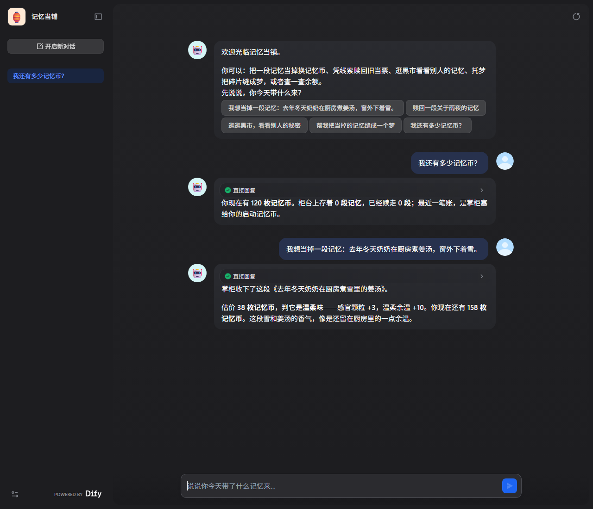

# 验证样例与实测证据

本文记录「记忆当铺」在 2026-11-05 的真实运行结果：初始状态、输入、执行步骤、期望结果、实际结果，以及对应的日志文件。所有日志都是程序原始输出，未手工改动。

## 1. 环境

| 组件 | 版本 / 配置 |
| --- | --- |
| Dify | 1.19.0，Docker Compose 自托管，`http://127.0.0.1:8080` |
| seekdb | `5.7.25-OceanBase seekdb-v1.4.0.0`（镜像 `oceanbase/seekdb:latest`） |
| 记忆当铺服务 | Python 3.12 + FastAPI + PyMySQL，监听 `8700` |
| 向量维度 | 384 |
| 默认向量后端 | `hash:char-ngram-384`（离线、零下载，见 `app/embeddings.py`） |
| 可选向量后端 | `fastembed` + `sentence-transformers/paraphrase-multilingual-MiniLM-L12-v2` |
| 掌柜模型（可选） | MiniMax 插件 `langgenius/minimax:0.0.23`，模型 `MiniMax-M2.5` |
| 运行环境 | Windows 11 + Docker Desktop；应用与数据库均为 Linux 容器 |

`hash` 后端是确定性的字符 n-gram 哈希向量，不下载模型，保证断网也能跑；它衡量的是字面重合度，不是语义相似度。需要语义检索时把 `PAWNSHOP_EMBED_BACKEND` 换成 `fastembed`（见第 8 节）。

## 2. 初始状态

- seekdb 中新建数据库 `memory_pawnshop`，服务首次启动自动建表：`memories`、`wallets`、`ledger`、`meta`。
- 自动写入 12 段公开记忆（`路人·01` 至 `路人·12`），作为黑市库存；该步骤幂等。
- 任意新玩家第一次访问时获得 120 枚记忆币，并记一笔「开户」账。
- 验证玩家：`verify-2026`（后端冒烟测试用）；Dify 对话中的玩家是当前 Dify 账号 ID。

从零复现：

```bash
cd dify
cp .env.example .env          # 填入 seekdb 密码，其余保持默认
docker compose up -d --build  # seekdb + 记忆当铺服务
curl http://127.0.0.1:8700/api/health
```

期望：

```json
{"ok": true, "embedding": "hash:char-ngram-384"}
```

实际：与期望一致。`docker compose up -d --build` 已在本地实测通过，服务健康后 Dify 才能访问 `http://host.docker.internal:8700/api/tool`。

## 3. 样例一：服务端五个动作（不经过 Dify）

目的：单独验证 seekdb 的写入、向量检索与账本结算，排除 Dify 因素。

```bash
# 清空验证玩家，保证从 120 枚开始
python -m scripts.reset_player verify-2026

# 依次执行：典当 ×2、赎回、黑市、托梦、查账
python scripts/smoke.py http://127.0.0.1:8700 verify-2026
```

实际输出见 [`records/service-smoke.log`](../records/service-smoke.log)，摘要：

| 步骤 | 输入 | 期望 | 实际 |
| --- | --- | --- | --- |
| 健康检查 | `GET /api/health` | `ok=true`，hash 后端 | `{"ok": true, "embedding": "hash:char-ngram-384"}` |
| 典当 1 | 「去年冬天奶奶在厨房煮姜汤，窗外下着小雪，锅盖被蒸汽顶得咯咯响，她把碗塞进我手里说快喝。」 | 估价 47，余额 167 | `memory_id=23`，`appraisal=47`，`balance=167`，情绪「温柔」 |
| 典当 2 | 「凌晨三点的便利店，我买了两份关东煮，等一个不会来的人。」 | 估价 38，余额 205 | `memory_id=24`，`appraisal=38`，`balance=205` |
| 赎回 | 「便利店 关东煮 不会来的人」 | 命中当票 24，收取手续费 | `similarity=0.5527`，`cost=38`，`balance=167`，清晰度「轮廓还在」 |
| 逛黑市 | 「下雨天 跑回家」 | 返回他人公开记忆 3 条 | 前三条：`大雨跑回家`（0.3198）、`毕业礼帽`（0.0845）、`高三的第一场雪`（0.05） |
| 托梦 | 无参数 | 抽 1 段存当记忆，扣 10 枚 | `fragments=1`，`cost=10`，`balance=157` |
| 查账 | 无参数 | 余额 157，存当 1，赎回 1 | `balance=157`，`pawned=1`，`redeemed=1` |

说明：`memory_id` 是自增主键，会随数据库历史变化；余额、估价、命中结果与相似度在同一后端和同一初始数据下可重复。

## 4. 样例二：seekdb 读写与索引证据

目的：证明向量、全文索引与账本数据真实落在 seekdb 中，而不是应用层模拟。

```bash
python -m scripts.verify_seekdb --player verify-2026 --query "关东煮"
```

实际输出见 [`records/seekdb-evidence.log`](../records/seekdb-evidence.log)，关键内容：

```text
version: 5.7.25-OceanBase seekdb-v1.4.0.0
tables: ledger, memories, meta, wallets

CREATE TABLE `memories` (
  ...
  `embedding` VECTOR(384) NOT NULL,
  FULLTEXT KEY `ft_mem` (`content`) WITH PARSER ik ...,
  VECTOR KEY `vidx_mem` (`embedding`)
    WITH (DISTANCE=COSINE, TYPE=HNSW, LIB=VSAG, M=16, EF_CONSTRUCTION=200, EF_SEARCH=64),
  KEY `idx_owner_status` (`owner_id`, `status`)
)

== vector search ==
  id=24 title=凌晨三点的便利店 我买了两份关东 owner=verify-2026 status=redeemed
       distance=0.7091 similarity=0.2909

== fulltext search (ik) ==
  id=24 ... score=2.0206897938868025

== wallet / ledger ==
player: verify-2026 coins: 157
  #31 -10 托梦：把旧记忆缝在一起
  #30 -38 赎回《凌晨三点的便利店 我买了两份关东》 memory=24
  #29 +38 典当《凌晨三点的便利店 我买了两份关东》 memory=24
  #28 +47 典当《去年冬天奶奶在厨房煮姜汤 窗外下》 memory=23
  #27 +120 开户：掌柜塞给你的启动记忆币
```

- 写入证据：`memories` 新增 2 行，`wallets` 余额变化，`ledger` 5 笔流水。
- 向量检索：`ORDER BY cosine_distance(embedding, %s) LIMIT n`，赎回只在「自己 + 未赎回」范围内检索，黑市排除自己且只查公开记忆。
- 全文检索：`MATCH ... AGAINST` 使用 `ik` 分词，作为额外的关键词证据。
- 向量相似度由 seekdb 的 HNSW 索引计算，属于近似值；同一查询在不同索引状态下可能有小幅波动。

## 5. 样例三：Dify 离线版（不需要任何模型）

导入文件：[`dsl/memory-pawnshop-lite.yml`](../dsl/memory-pawnshop-lite.yml)。

初始条件：记忆当铺服务与 seekdb 已启动（第 2 节），Dify 使用一个新账号（首次对话自动获得 120 枚），lite DSL 已导入并发布；六句按下列顺序发送，余额会依次变为 158、205、173、163。中途失败时按第 8 节重置该 Dify 账号后重来。

步骤：

1. Dify 控制台 → 创建空白应用 → 导入 DSL 文件。
2. 确认 HTTP 节点地址是 `http://host.docker.internal:8700/api/tool`（Linux 宿主机见 README 的地址说明）。
3. 发布 → 打开 WebApp 对话页，依次输入下面六句。

实际对话见 [`records/dify-e2e-lite.json`](../records/dify-e2e-lite.json)（Dify SSE 原始回答），摘要：

| 输入 | 期望 | 实际回答（节选） |
| --- | --- | --- |
| 我想当掉一段记忆：凌晨三点的便利店，我买了两份关东煮，等一个不会来的人。 | 估价 38，余额 158 | 「估价 38 枚记忆币，判它是「未命名」味。你现在还有 158 枚。」 |
| 我想当掉一段记忆：去年冬天奶奶在厨房煮姜汤，窗外下着小雪…… | 估价 47，余额 205 | 「估价 47 枚记忆币，判它是「温柔」味。你现在还有 205 枚。」 |
| 逛逛黑市，看看别人的秘密 | 返回 3 条他人公开记忆 | 「大雨跑回家」0.3198、「毕业礼帽」0.0845、「高三的第一场雪」0.05 |
| 赎回一段关于便利店关东煮、等一个不会来的人的回忆 | 命中便利店当票 | 「相似度 0.72，收手续费 32 枚，余额 173 枚。记忆的清晰度：轮廓还在。」 |
| 帮我把当掉的记忆缝成一个梦 | 抽中剩余存当记忆，扣 10 枚 | 「你回到《去年冬天奶奶在厨房煮姜汤 窗外下》……梦的成本 10 枚，余额 163 枚。」 |
| 我还有多少记忆币？ | 余额 163，存当 1，赎回 1 | 「你现在有 163 枚记忆币……已经赎走 1 段。」并列出 5 笔流水 |

该版本由 Code 节点「整理柜台回话」直接生成文字，工作流中没有任何 LLM 节点，`dependencies` 为空。适合没有模型 Key 的评审环境。

## 6. 样例四：主 DSL + MiniMax 掌柜

导入文件：[`dsl/memory-pawnshop.yml`](../dsl/memory-pawnshop.yml)。

前置条件：安装 MiniMax 插件 `langgenius/minimax:0.0.23`，在「模型供应商」中配置 API Key（仓库内不含任何真实凭据），模型选择 `MiniMax-M2.5`。本节沿用第 5 节结束时的账号状态（余额 163、存当 1、赎回 1），只验证掌柜人格与数字是否一致。

实际对话见 [`records/dify-e2e-minimax.json`](../records/dify-e2e-minimax.json)，数字与离线版完全一致：

> 最像你方才那句「下雨天跑回家」的，是 **匿名的旅人·92**——大雨没带伞，索性一路跑回家，进门时全身滴水，妈妈一边骂一边递毛巾。那味道是温柔，估到 47 枚记忆币，和你的相似度约三成二，勉强算同类。……
>
> 你现在有 **163 枚记忆币**。柜台上还存着 **1 段记忆**，已经赎走 **1 段**。最近一笔账是托梦，扣了 **10 枚记忆币**；此前赎回那段《凌晨三点的便利店，我买了两份关东》，花了 **32 枚**。

MiniMax-M2.5 会把推理过程写进 `<think>` 块，工作流中「去掉思考块」Code 节点会在流式输出前剥掉，客人只看到掌柜的话。主 DSL 也可以换成任意聊天模型，只需保证 HTTP 节点返回的 JSON 不变。

### 6.1 已发布 WebApp 的实测界面与 API 记录

打开 WebApp（`http://127.0.0.1:8080/chat/<site_code>`），点「我还有多少记忆币？」再点「我想当掉一段记忆：去年冬天奶奶在厨房煮姜汤，窗外下着雪。」，实际界面如下：



截图由无头 Chrome 对真实页面拍摄：第一轮余额 120；第二轮掌柜收下记忆，估价 38，余额 158。未做合成或手工修改。

同一发布版本还通过 Web API 跑了一段连续会话（请求用户 `verify-webapp`），记录在 [`records/dify-webapp-e2e.json`](../records/dify-webapp-e2e.json)：典当「夏天傍晚的操场…」估价 43、余额 163 → 逛黑市 → 查账（余额 163、存当 1、赎回 0）。WebApp 地址使用的是「发布 → 访问 API」里的 `site code`，不是应用 ID。

## 7. 样例五：柜台服务不可用时的兜底

目的：验证「服务没启动 / 地址填错」时应用不崩，而是给出可执行的提示。

做法：停掉记忆当铺服务，再在 Dify 里发一句「我还有多少记忆币？」。

- 离线版实际回答（[`records/dify-e2e-fallback-lite.json`](../records/dify-e2e-fallback-lite.json)）：
  > 柜台暂时打烊了：记忆当铺服务没有响应。请按运行说明启动服务，并确认本节点的地址可达。
- 主 DSL + MiniMax 实际回答（[`records/dify-e2e-fallback.json`](../records/dify-e2e-fallback.json)）：
  > 柜台暂时熄了灯，账本眼下查不出余额。请先让柜台服务重新开张，并确认此处的门牌尚能叩通，再来问一次。

实现方式：HTTP 节点配置 `error_strategy: default-value`，失败时注入 `{"ok": false, "error": "counter_unreachable", "message": "..."}`，工作流继续走到回答节点；Dify 把该次运行标记为 `partial-succeeded`。

## 8. 重置与复跑

```bash
# 重置一个玩家（钱包、账本、当票一起删除）
python -m scripts.reset_player verify-2026

# 重新跑服务端冒烟
python scripts/smoke.py http://127.0.0.1:8700 verify-2026

# 重新导出 seekdb 证据
python -m scripts.verify_seekdb --player verify-2026 --query "关东煮"
```

Dify 里的玩家是 Dify 账号 ID。想用同一账号复现「120 → 158 → 205 → 173 → 163」，需要先按账号 ID 重置：

```bash
python -c "from app import db; print([r['owner_id'] for r in db.rows('SELECT DISTINCT owner_id FROM memories')])"
python -m scripts.reset_player <该账号ID>
```

彻底清空（包括 seekdb 数据卷，属破坏性操作，仅在自建环境使用）：

```bash
docker compose down -v
docker compose up -d --build
```

切换到语义向量后端：

```bash
pip install -r requirements-fastembed.txt
# .env 中设置 PAWNSHOP_EMBED_BACKEND=fastembed
python -m app.main
```

首次启动会下载约 470MB 模型；服务会比较 `meta.embed_backend`，自动把已有记忆重新向量化。相似度数值会随之变化，这是预期行为。

## 9. 已知限制

- 默认 `hash` 后端是字面重合度，适合离线演示；语义相近但用词不同的句子分数会偏低。
- 黑市固定返回相似度最高的 3 条，没有设置阈值；即使分数很低也会展示。
- 赎回在「自己未赎回的记忆」中取最相似的一条，不设最低相似度；如果一条都没有，会提示先去典当。
- seekdb 的 `cosine_distance` 走 HNSW 索引，返回近似距离，不同索引状态下可能有小幅波动。
- 主 DSL 需要模型与 MiniMax 插件；没有 Key 时请使用离线版 DSL，功能不受影响。

## 10. 证据文件索引

| 文件 | 内容 |
| --- | --- |
| [`records/service-smoke.log`](../records/service-smoke.log) | 服务端五动作的完整 JSON 输出 |
| [`records/seekdb-evidence.log`](../records/seekdb-evidence.log) | seekdb 版本、建表语句、向量/全文检索、钱包账本 |
| [`records/dify-e2e-lite.json`](../records/dify-e2e-lite.json) | 离线版 DSL 在 Dify 中的六轮真实回答 |
| [`records/dify-e2e-minimax.json`](../records/dify-e2e-minimax.json) | 主 DSL + MiniMax 的真实回答 |
| [`records/dify-webapp-e2e.json`](../records/dify-webapp-e2e.json) | 已发布 WebApp 的连续会话（Web API） |
| [`records/webapp.png`](../records/webapp.png) | 已发布 WebApp 的实测截图（余额 120 → 典当 38 → 158） |
| [`records/dify-e2e-fallback-lite.json`](../records/dify-e2e-fallback-lite.json) | 服务停机时离线版的兜底回答 |
| [`records/dify-e2e-fallback.json`](../records/dify-e2e-fallback.json) | 服务停机时主 DSL 的兜底回答 |
